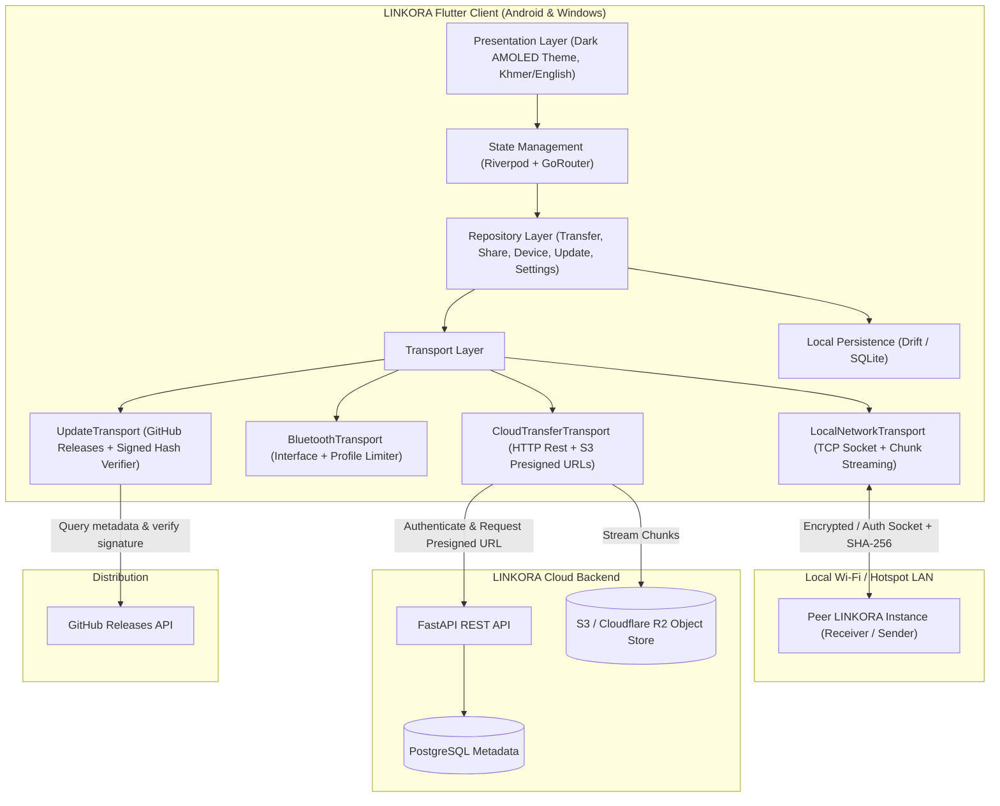

# LINKORA Architecture Blueprint

## 1. Overview
**LINKORA** is a secure, cross-platform file sharing and transfer platform targeting **Android APK** and **Windows 10/11 Desktop EXE**. It bridges two complementary transfer paradigms:
1. **Direct Device-to-Device Transfer**: Offline local Wi-Fi / LAN streaming and Bluetooth transfer interfaces with QR-pairing and SHA-256 integrity checks.
2. **Online Cloud Sharing**: FastAPI + PostgreSQL + S3-compatible (Cloudflare R2 / AWS S3) upload and download links with cryptographic token hashing, expiration, password protection, and download limits.
3. **Secure Auto-Updates**: GitHub Releases discovery, semantic versioning, SHA-256 validation, and signed manifest verification.

---

## 2. System Architecture

---

## 3. Core Color Tokens & Design System
- **Background**: `#0D0F14` (Deep obsidian)
- **Surface**: `#171A23` (Charcoal container)
- **Elevated Surface**: `#212635` (High-contrast cards)
- **Primary Accent**: `#9878FF` (Electric violet)
- **Secondary Accent**: `#55D6C2` (Cyan mint)
- **Main Text**: `#F4F5FA` (Near-white)
- **Secondary Text**: `#A1A7B7` (Cool muted gray)
- **Success**: `#57D6C5`
- **Warning**: `#FFBE69`
- **Error**: `#FF647C`
- **Border**: `#343746`

---

## 4. Transfer States
Every file transfer follows an explicit state machine:
`Idle` → `Queued` → `Preparing` → `Connecting` → `Running` → `Paused` → `Verifying` → `Completed` (or `Cancelled` / `Failed`).

---

## 5. Security Principles
- **Zero Plaintext Tokens**: Share access tokens are hashed using SHA-256 before storage in PostgreSQL.
- **Password Protection**: Passwords for share links are hashed using bcrypt / Argon2.
- **Integrity Guarantee**: Streams are computed for SHA-256 in real-time and checked on receipt before saving.
- **Path Traversal Protection**: Sanitize filenames and reject path separators (`../`, `..\`) on incoming files.
- **Signed Auto Updates**: Release manifests must match cryptographic signatures before installer execution.
